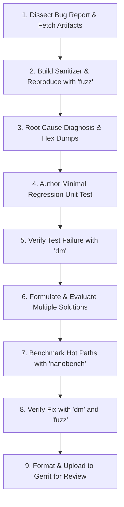

# Skia Fuzzer Workflow

This skill provides an authoritative, end-to-end runbook for dissecting fuzzer-reported bugs,
isolating root causes, creating regression tests, evaluating and benchmarking candidate solutions,
and uploading the final change to Gerrit for user review.

---

## Core Principles

- **Reproduce Before Fixing**: Always confirm the crash or sanitizer violation locally using the
  `fuzz` binary before touching production code.
- **Hermeticity**: Use dedicated build directories (e.g. `out/ASAN`, `out/DebugFuzz`) and
  hermetic GN flags (`skia_use_fontconfig=false`, `skia_enable_fontmgr_custom_empty=true`).
  **NEVER** overwrite existing user build directories like `out/Debug`.
- **Exact Numeric Representation**: When reproducing floating-point bugs, **NEVER** use rounded
  decimal strings. Use `path.dumpHex()` and `SkBits2Float(0x...)` to preserve exact bitwise values
  across compilers and platforms.
- **Multiple Solution Exploration**: Never settle on the first quick hack. Formulate distinct
  solution approaches (e.g. local defensive guard vs root-cause math vs upstream parser validation),
  evaluate their trade-offs against performance and maintainability, and benchmark hot paths using
  `nanobench`.
- **Clean Gerrit Delivery**: Upload an impeccably formatted CL (`git clang-format`) containing both
  the fix and reproduction test, complete with required tags (`TAG=agy`, `CONV=`, `Bug:`), and
  present the Gerrit review link to the user.

---

## Workflow Steps



### Step 1: Ingest & Dissect the Bug Report
Extract key parameters from ClusterFuzz, OSS-Fuzz, or Buganizer:
- **Bug ID**: e.g., `b/123456789` or `oss-fuzz:12345`.
- **Crash Type**: ASAN heap-buffer-overflow, MSAN uninitialized value, UBSAN integer overflow,
  SIGSEGV, or `SkASSERT` failure.
- **Fuzzer Target**: e.g., `api`, `path_deserialize`, `sksl2glsl`, `image_decode`, `skp`.
- **Testcase File**: Download the minimized reproducer bytes to a scratch directory.

*Detailed Guide*: [Reproduction & Sanitizers](references/reproduction_and_sanitizers.md)

### Step 2: Hermetic Sanitizer Setup & Reproduction
Configure a dedicated build directory with AddressSanitizer and hermetic font/dependency flags:
```bash
./bin/gn gen -q out/ASAN --args='
  is_debug = true
  sanitize = "ASAN"
  skia_use_fontconfig = false
  skia_enable_fontmgr_custom_empty = true
'
ninja --quiet -C out/ASAN fuzz
out/ASAN/fuzz -b /path/to/testcase
```
If the type is not auto-detected from the filename, explicitly supply `-t <type>` and optional
`-n <name>` (e.g. `out/ASAN/fuzz -t api -n RasterN32Canvas -b /path/to/testcase`).

### Step 3: Pinpoint Root Cause & Extract Exact Floats
Inspect the stack trace under GDB/LLDB or add temporary debug instrumentation:
- **Dump Hex Coordinates**: For `SkPath` bugs, invoke `path.dumpHex()` in debug code to output
  exact builder calls using `SkBits2Float(0x...)`.
- **Scientific Logging**: Print matrix/scalar values using scientific notation (`%.10e`) or raw
  bit patterns (`SkFloat2Bits`).
- **Classify the Root Cause**:
  - Geometric/Math instability (degenerate conic, collinear cubic, division by zero).
  - Buffer overrun or missing bounds check during deserialization.
  - Assert violation on invalid or unexpected state.

### Step 4: Write a Minimal Reproduction Unit Test
Translate the fuzzed inputs into a standalone C++ unit test in `tests/`:
- Name the test after the bug (e.g. `DEF_TEST(Fuzz_b123456789, reporter)`).
- Use `SkBits2Float(0x...)` for all coordinates.
- Wrap sub-operations in `skiatest::ReporterContext` for actionable error output.
- Reference existing examples:
  - Geometry:
    [ClipCubicTest.cpp:L175-L211](../../../tests/ClipCubicTest.cpp#L175-L211)
    within `DEF_TEST(test_fuzz_crbug_698714, reporter)`
  - Deserialization:
    [RoundRectTest.cpp:L1652-L1680](../../../tests/RoundRectTest.cpp#L1652-L1680)
    within `DEF_TEST(RRect_fuzzer_regressions, r)`
- If adding a new test file, register it in `gn/tests.gni`
  (see [skia-add-test](../skia-add-test/SKILL.md)).

### Step 5: Verify Test Failure
Confirm that the new unit test fails or asserts under `dm` before applying any fix:
```bash
ninja --quiet -C out/Debug dm
out/Debug/dm --src tests --match Fuzz_b123456789
```
> [!IMPORTANT]
> A reproduction test that passes before the fix is applied does not properly reproduce the bug.
> Verify failure first!

### Step 6: Iterate on Potential Solutions

1. **Approach A (Root Cause / Mathematical)**: Fix the underlying math (e.g. robust root finding,
   clamping negative discriminants, epsilon handling).
2. **Approach B (Upstream Validation)**: Reject or sanitize corrupt inputs during deserialization
   or parameter ingestion.
3. **Approach C (Defensive Guard)**: Add a local null/zero/bounds guard at the point of failure.

### Step 7: Benchmark Performance with `nanobench`
If the fix affects a hot rendering path, verify zero performance regression using an optimized
Release build:
```bash
./bin/gn gen -q out/Release --args='is_debug=false'
ninja --quiet -C out/Release nanobench
cp out/Release/nanobench ./nanobench_control

# Recompile with candidate patch
ninja --quiet -C out/Release nanobench

# Run comparative benchmarks
./nanobench_control --match <affected_ops> --samples 15 --ms 100 > baseline.txt
out/Release/nanobench --match <affected_ops> --samples 15 --ms 100 > patch.txt
```

### Step 8: Verify Complete Fix and Clean Up
1. Verify the reproduction unit test passes:
   ```bash
   out/Debug/dm --src tests --match Fuzz_b123456789
   ```
2. Verify the original fuzzer binary exits cleanly on the testcase:
   ```bash
   out/ASAN/fuzz -b /path/to/testcase
   ```
3. Run broader subsystem tests and GMs to ensure no regressions:
   ```bash
   out/Debug/dm --src tests gm --match <affected_subsystem>
   ```
4. **Remove all temporary debug logs** (`dumpHex`, `SKIA_LOG_D`, `SkDebugf`).

### Step 9: Format, Commit, and Upload to Gerrit
1. Create a topic branch:
   ```bash
   git checkout -b fix-fuzz-b123456789 origin/main
   ```
2. Format the code:
   ```bash
   git clang-format origin/main
   ```
3. Commit with required Google and Skia footers:
   ```text
   [<subsystem>] Fix crash on degenerate fuzzer input

   <Detailed description of root cause, fix rationale, and alternatives evaluated.>

   Reproduction test added to tests/<TestFile>.cpp.

   Bug: b/123456789
   TAG=agy
   CONV=<conversation_id>
   ```
4. Upload to Gerrit:
   ```bash
   git cl upload -f -s --cq-dry-run
   ```
5. Share the resulting Gerrit URL with the user for review.

---

## Related Skills & References
- Build workflows and tool flags: [skia-gn-workflow](../skia-gn-workflow/SKILL.md)
- Adding new test files to the build: [skia-add-test](../skia-add-test/SKILL.md)
