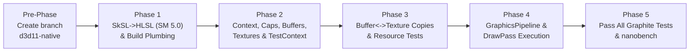

# Experimental D3D11.1 Backend in Skia Graphite (`kD3D11`)

## Goal Description
Implement a native **Direct3D 11.1 (`BackendApi::kD3D11`)** backend in Skia Graphite (`src/gpu/graphite/d3d11`) on a new git branch **`d3d11-native`**, split into 5 incremental phases. Each phase compiles cleanly with `autoninja -C out/Release nanobench dm`, verifies progressively more tests in `tests/graphite/`, and creates a dedicated git commit before moving to the next phase. The final phase's acceptance criteria is passing all applicable tests in `tests/graphite/` and running `nanobench` performance comparisons.



---

## Phased Execution Plan & Acceptance Criteria

### Pre-Phase: Branch Setup
- Create and switch to branch `d3d11-native`:
  ```powershell
  git checkout -b d3d11-native
  ```

---

### Phase 1: Shader Translation (`SkSL -> SPIR-V -> SPIRV-Cross (SM 5.0)`) & Build System Plumbing
**Goal**: Support Shader Model 5.0 HLSL codegen via SPIRV-Cross and wire up `skia_use_d3d11` and `BackendApi::kD3D11` in GN and core Graphite types.

#### Proposed Changes
- **[MODIFY] [SkSLSPIRVtoHLSL.h](file:///C:/src/skia/src/sksl/codegen/SkSLSPIRVtoHLSL.h) & [SkSLSPIRVtoHLSL.cpp](file:///C:/src/skia/src/sksl/codegen/SkSLSPIRVtoHLSL.cpp)**
  - Add `uint32_t shaderModel = 51` parameter to `SkSL::SPIRVtoHLSL` so D3D11 can request `shader_model = 50` while Ganesh D3D12 defaults to `51`.
  - Support `optionsHLSL.support_nonzero_base_vertex_base_instance` or vertex/instance offset handling as needed.
- **[MODIFY] [SkSLHLSLCodeGenerator.h](file:///C:/src/skia/src/sksl/codegen/SkSLHLSLCodeGenerator.h), [SkSLHLSLCodeGenerator.cpp](file:///C:/src/skia/src/sksl/codegen/SkSLHLSLCodeGenerator.cpp), & [SkSLToBackend.h](file:///C:/src/skia/src/gpu/SkSLToBackend.h)**
  - Plumb `shaderModel` through `SkSL::ToHLSL` / `skgpu::SkSLToHLSL`.
- **[MODIFY] [GpuTypes.h](file:///C:/src/skia/include/gpu/GpuTypes.h), [GpuTypesPriv.h](file:///C:/src/skia/src/gpu/GpuTypesPriv.h), [TextureInfo.h](file:///C:/src/skia/include/gpu/graphite/TextureInfo.h), & [BackendTexture.cpp](file:///C:/src/skia/src/gpu/graphite/BackendTexture.cpp)**
  - Add `BackendApi::kD3D11`, update `BackendApiToStr`, add `friend class D3D11TextureInfo`, and allow `BackendApi::kD3D11` in `assert_is_supported_backend`.
- **[MODIFY] [skia.gni](file:///C:/src/skia/gn/skia.gni), [graphite.gni](file:///C:/src/skia/gn/graphite.gni), & [BUILD.gn](file:///C:/src/skia/BUILD.gn)**
  - Add `skia_use_d3d11 = false` to `gn/skia.gni`.
  - When `skia_use_d3d11` is enabled, include `skia_sksl_hlsl_sources` and `//third_party/spirv-cross:spirv_cross` in `gpu_shared`, and define `SK_D3D11` + link `d3d11.lib`, `dxgi.lib`, `d3dcompiler.lib` in `graphite`.

#### Phase 1 Verification & Commit
- Enable `skia_use_d3d11 = true` in `out/Release/args.gn`, run `.\bin\gn.exe gen out/Release`, and verify compilation with:
  ```powershell
  autoninja -C out/Release nanobench dm
  ```
- Create commit: `git commit -m "Phase 1: Add kD3D11 enum, SM 5.0 SPIRV-Cross HLSL support, and GN build plumbing"`

---

### Phase 2: D3D11.1 Context, Caps, Resource Skeleton & Test Harness (`tests/graphite` Context & Buffer Tests)
**Goal**: Bring up `D3D11BackendContext`, `D3D11Caps`, `D3D11SharedContext`, `D3D11QueueManager`, `D3D11ResourceProvider`, `D3D11Buffer`, `D3D11Texture`, `D3D11Sampler`, and `GraphiteD3D11TestContext` (`--config grd3d11`), and pass basic context/recorder/buffer unit tests in `tests/graphite/`.

#### Proposed Changes
- **[NEW] [D3D11BackendContext.h](file:///C:/src/skia/include/gpu/graphite/d3d11/D3D11BackendContext.h) & [D3D11GraphiteTypes.h](file:///C:/src/skia/include/gpu/graphite/d3d11/D3D11GraphiteTypes.h)**
  - Define `D3D11BackendContext` (`IDXGIAdapter1`, `ID3D11Device1`, `ID3D11DeviceContext1`), `D3D11TextureInfo`, `BackendTextures::MakeD3D11`, and `ContextFactory::MakeD3D11`.
- **[NEW] [D3D11Caps.h](file:///C:/src/skia/src/gpu/graphite/d3d11/D3D11Caps.h) & [D3D11Caps.cpp](file:///C:/src/skia/src/gpu/graphite/d3d11/D3D11Caps.cpp)**
  - Configure `fDrawBufferCanBeMapped = false`, `fBufferMapsAreAsync = false`, `fStorageBufferSupport = false`, `fComputeSupport = false`, `fRequiredUniformBufferAlignment = 256`, `fRequiredTransferBufferAlignment = 16`, and query `ID3D11Device1::CheckFormatSupport` / `CheckMultisampleQualityLevels1` for all DXGI formats.
- **[NEW] [D3D11SharedContext.h](file:///C:/src/skia/src/gpu/graphite/d3d11/D3D11SharedContext.h) & [D3D11SharedContext.cpp](file:///C:/src/skia/src/gpu/graphite/d3d11/D3D11SharedContext.cpp)**
- **[NEW] [D3D11QueueManager.h](file:///C:/src/skia/src/gpu/graphite/d3d11/D3D11QueueManager.h) & [D3D11QueueManager.cpp](file:///C:/src/skia/src/gpu/graphite/d3d11/D3D11QueueManager.cpp)**
  - Implement command buffer submission and `D3D11WorkSubmission` using `ID3D11Query` (`D3D11_QUERY_EVENT`).
- **[NEW] [D3D11ResourceProvider.h](file:///C:/src/skia/src/gpu/graphite/d3d11/D3D11ResourceProvider.h) & [D3D11ResourceProvider.cpp](file:///C:/src/skia/src/gpu/graphite/d3d11/D3D11ResourceProvider.cpp)**
- **[NEW] [D3D11Buffer.h](file:///C:/src/skia/src/gpu/graphite/d3d11/D3D11Buffer.h) & [D3D11Buffer.cpp](file:///C:/src/skia/src/gpu/graphite/d3d11/D3D11Buffer.cpp)**
  - Support all `BufferType` values (`kVertex`, `kIndex`, `kUniform`, `kStorage`, `kVertexStorage`, `kIndexStorage`, `kIndirect` as `D3D11_USAGE_DEFAULT` `ID3D11Buffer`s; `kXferCpuToGpu` as aligned CPU memory; `kXferGpuToCpu` with staging readback support).
- **[NEW] [D3D11Texture.h](file:///C:/src/skia/src/gpu/graphite/d3d11/D3D11Texture.h) & [D3D11Texture.cpp](file:///C:/src/skia/src/gpu/graphite/d3d11/D3D11Texture.cpp)**
  - Create `ID3D11Texture2D` and SRV / RTV / DSV views.
- **[NEW] [D3D11Sampler.h](file:///C:/src/skia/src/gpu/graphite/d3d11/D3D11Sampler.h) & [D3D11Sampler.cpp](file:///C:/src/skia/src/gpu/graphite/d3d11/D3D11Sampler.cpp)**
- **[NEW] Skeleton [D3D11GraphicsPipeline.h/.cpp](file:///C:/src/skia/src/gpu/graphite/d3d11/D3D11GraphicsPipeline.h) & [D3D11CommandBuffer.h/.cpp](file:///C:/src/skia/src/gpu/graphite/d3d11/D3D11CommandBuffer.h)**
- **[NEW] [GraphiteD3D11TestContext.h](file:///C:/src/skia/tools/graphite/d3d11/GraphiteD3D11TestContext.h) & [GraphiteD3D11TestContext.cpp](file:///C:/src/skia/tools/graphite/d3d11/GraphiteD3D11TestContext.cpp)**
- **[MODIFY] [ContextType.h](file:///C:/src/skia/tools/gpu/ContextType.h), [ContextType.cpp](file:///C:/src/skia/tools/gpu/ContextType.cpp), [ContextFactory.cpp](file:///C:/src/skia/tools/graphite/ContextFactory.cpp), [CommonFlagsConfig.cpp](file:///C:/src/skia/tools/flags/CommonFlagsConfig.cpp), & [DMGpuTestProcs.cpp](file:///C:/src/skia/dm/DMGpuTestProcs.cpp)**
  - Register `ContextType::kD3D11` and `--config grd3d11`, and allow `RunWithGraphiteTestContexts` to filter to the requested `--config` context type when specified.

#### Phase 2 Verification & Commit
- Compile and run `tests/graphite` context/buffer tests on `grd3d11`:
  ```powershell
  autoninja -C out/Release nanobench dm
  .\out\Release\dm.exe --config grd3d11 --src tests --nogpu --nocpu --match RecorderDevicePtrTest BufferManager UploadBufferManager GraphiteContextRecorderTest SubmitWithFinishProcTest
  ```
- Create commit: `git commit -m "Phase 2: Implement D3D11 context, caps, resources, and test harness"`

---

### Phase 3: Copy Operations (`Buffer <-> Texture`, `Buffer <-> Buffer`, `Texture <-> Texture`) & Resource Tests
**Goal**: Implement all copy commands and staging readbacks in `D3D11CommandBuffer` and `D3D11Buffer`, plus render target clearing and MSAA resolve, and pass texture/cache/copy tests in `tests/graphite/`.

#### Proposed Changes
- **[MODIFY] [D3D11CommandBuffer.h](file:///C:/src/skia/src/gpu/graphite/d3d11/D3D11CommandBuffer.h), [D3D11CommandBuffer.cpp](file:///C:/src/skia/src/gpu/graphite/d3d11/D3D11CommandBuffer.cpp), & [D3D11Buffer.cpp](file:///C:/src/skia/src/gpu/graphite/d3d11/D3D11Buffer.cpp)**
  - `onCopyBufferToBuffer`: `UpdateSubresource1` from `kXferCpuToGpu` CPU memory to `D3D11_USAGE_DEFAULT` GPU buffer (or `CopySubresourceRegion` between GPU buffers, including into `kXferGpuToCpu` staging buffers).
  - `onCopyBufferToTexture`: `UpdateSubresource1` from `kXferCpuToGpu` CPU memory into `ID3D11Texture2D` mips/subresources (handling 4x4 block alignment for BC1 compressed textures).
  - `onCopyTextureToTexture`: `CopySubresourceRegion` between `ID3D11Texture2D` resources.
  - `onCopyTextureToBuffer`: `CopySubresourceRegion` from source `ID3D11Texture2D` into a 2D `D3D11_USAGE_STAGING` (`D3D11_CPU_ACCESS_READ`) texture attached to the destination `kXferGpuToCpu` `D3D11Buffer`; mapped in `D3D11Buffer::onMap()` after GPU completion.
  - `onClearBuffer`: clears GPU buffer range via `UpdateSubresource1` or `ClearUnorderedAccessViewUint`.
  - RenderPass attachment setup in `onAddRenderPass`: `OMSetRenderTargets`, `LoadOp::kClear` (`ClearRenderTargetView` / `ClearDepthStencilView`), `LoadOp::kDiscard` / `StoreOp::kDiscard` (`DiscardView`), and MSAA `ResolveSubresource`.

#### Phase 3 Verification & Commit
- Compile and verify resource, backend texture, and pixel upload/readback tests in `tests/graphite/`:
  ```powershell
  autoninja -C out/Release nanobench dm
  .\out\Release\dm.exe --config grd3d11 --src tests --nogpu --nocpu --match BackendTextureTest UpdateBackendTextureTest GraphiteResourceCacheTest ProxyCacheTest TextureProxyTest
  ```
- Create commit: `git commit -m "Phase 3: Implement D3D11 buffer/texture copy operations and staging readbacks"`

---

### Phase 4: Full Graphics Pipeline (`D3D11GraphicsPipeline`) & Draw Execution (`D3D11CommandBuffer`)
**Goal**: Compile Graphite shaders to `ID3D11VertexShader` / `ID3D11PixelShader`, create `ID3D11InputLayout` and pipeline state objects, execute all `DrawPassCommands` in `D3D11CommandBuffer`, and pass core rendering tests in `tests/graphite/`.

#### Proposed Changes
- **[MODIFY] [D3D11GraphicsPipeline.h](file:///C:/src/skia/src/gpu/graphite/d3d11/D3D11GraphicsPipeline.h) & [D3D11GraphicsPipeline.cpp](file:///C:/src/skia/src/gpu/graphite/d3d11/D3D11GraphicsPipeline.cpp)**
  - Generate SkSL via `ShaderInfo::Make`, translate to SM 5.0 HLSL via `SkSL::ToHLSL`, and compile with `D3DCompile` (`vs_5_0`, `ps_5_0`, `D3DCOMPILE_PACK_MATRIX_ROW_MAJOR | D3DCOMPILE_OPTIMIZATION_LEVEL3`).
  - Create `ID3D11InputLayout` for static attributes (slot `0`) and append attributes (slot `1`) using `TEXCOORD<N>` semantics.
  - Create/cache `ID3D11BlendState` (supporting standard and dual-source blending), `ID3D11DepthStencilState`, and `ID3D11RasterizerState`.
- **[MODIFY] [D3D11CommandBuffer.cpp](file:///C:/src/skia/src/gpu/graphite/d3d11/D3D11CommandBuffer.cpp)**
  - Update intrinsic constant buffer (`register(b0)`) with `viewport` and `dstReadBounds`.
  - Execute `BindGraphicsPipeline`, `BindUniformBuffer` (`VSSetConstantBuffers1` / `PSSetConstantBuffers1`), `BindStaticDataBuffer`, `BindAppendDataBuffer`, `BindIndexBuffer`, `BindTexturesAndSamplers` (including `fDstCopy` and `storageFallbackTexture`), `SetScissor`, `SetBlendConstants`, and `Draw` / `DrawIndexed` / `DrawInstanced` / `DrawIndexedInstanced`.
  - Handle non-zero `baseVertex` / `baseInstance` properly (via `IASetVertexBuffers` byte offsets and/or SPIRV-Cross `SPIRV_Cross_VertexInfo` cbuffer when `sk_VertexID` / `sk_InstanceID` is used).

#### Phase 4 Verification & Commit
- Compile and run rendering tests in `tests/graphite/`:
  ```powershell
  autoninja -C out/Release nanobench dm
  .\out\Release\dm.exe --config grd3d11 --src tests --nogpu --nocpu --match RectTest ShapeTest TransformTest SwizzleTest RTEffectTest ImageShaderTest ImageOriginTest DrawAtlasTest MultisampleTest ReadWritePixelsGraphiteTest
  ```
- Create commit: `git commit -m "Phase 4: Implement D3D11GraphicsPipeline and DrawPass command execution"`

---

### Phase 5: Pass All `tests/graphite` Tests & Run `nanobench`
**Goal**: Resolve any remaining failures across the entire `tests/graphite/` directory, pass all Graphite unit tests, and verify `nanobench` benchmarking.

#### Proposed Changes
- Debug and fix any edge cases across remaining tests in `tests/graphite/` (such as `TextureFormatTest`, `TextureFallbackTest`, `VerticesPaddingTest`, `ImageWrapTextureMipmapsTest`, `GraphitePromiseImageTest`, `GraphiteYUVAPromiseImageTest`, `MutableImagesTest`, `NotifyInUseTest`, `PipelineCallbackTest`, `PersistentPipelineStorageTest`, `StorageContextTest`, `DeviceTest`, `InnerFillTest`).
- Ensure any backend-specific test hooks (e.g., `ManagedBackendTexture` / `BackendSurfaceFactory` if needed by promise image or backend texture tests) support `BackendApi::kD3D11`.

#### Phase 5 Acceptance Criteria & Commit
1. Compile with `autoninja -C out/Release nanobench dm` and run the entire Graphite test suite on `grd3d11` with **0 failures**:
   ```powershell
   autoninja -C out/Release nanobench dm
   .\out\Release\dm.exe --config grd3d11 --src tests --nogpu --nocpu
   ```
2. Run `nanobench` comparing `grd3d11` vs `grdawn_d3d11`:
   ```powershell
   .\out\Release\nanobench.exe --benchType playback --config grd3d11 grdawn_d3d11 --match rect
   ```
3. Create final commit on `d3d11-native`: `git commit -m "Phase 5: Pass all Graphite tests on D3D11 backend"`
