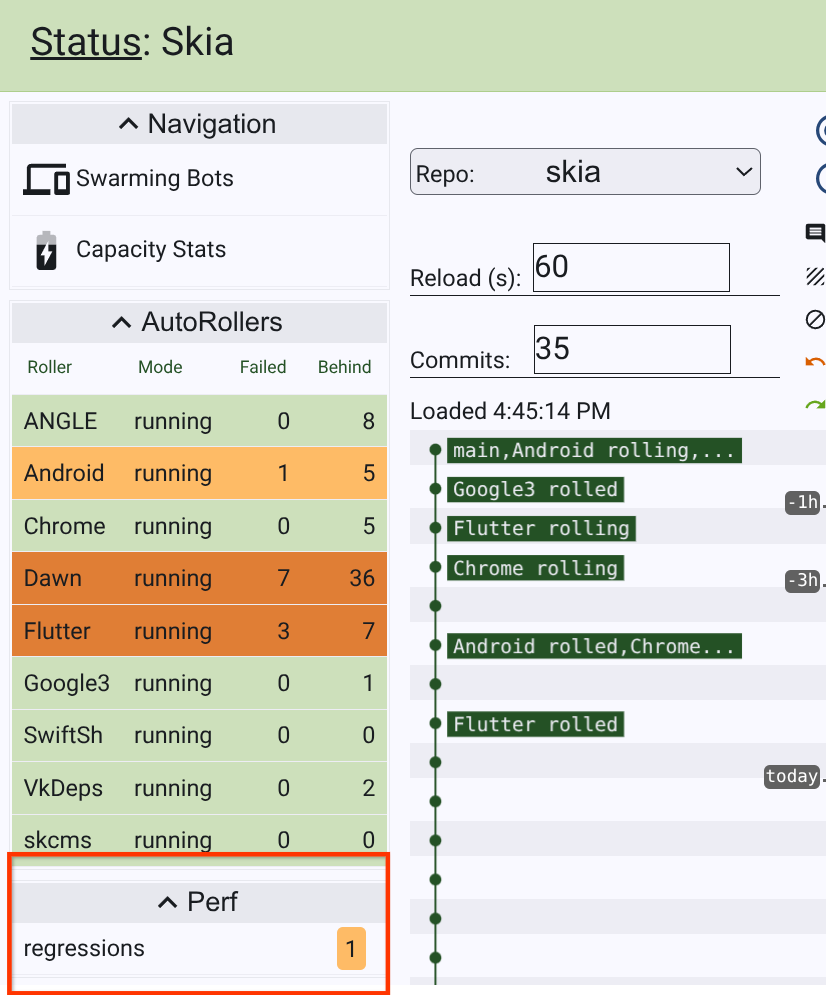
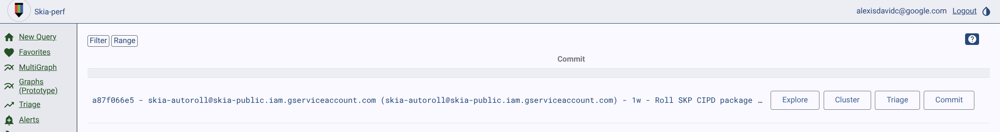
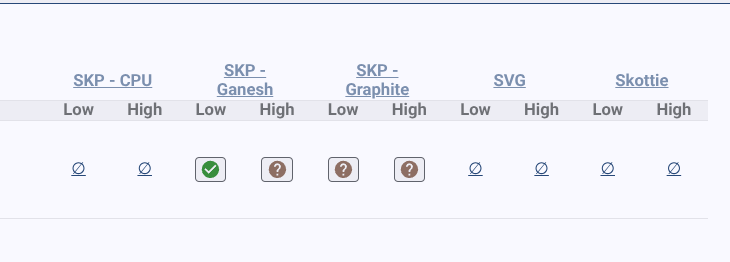
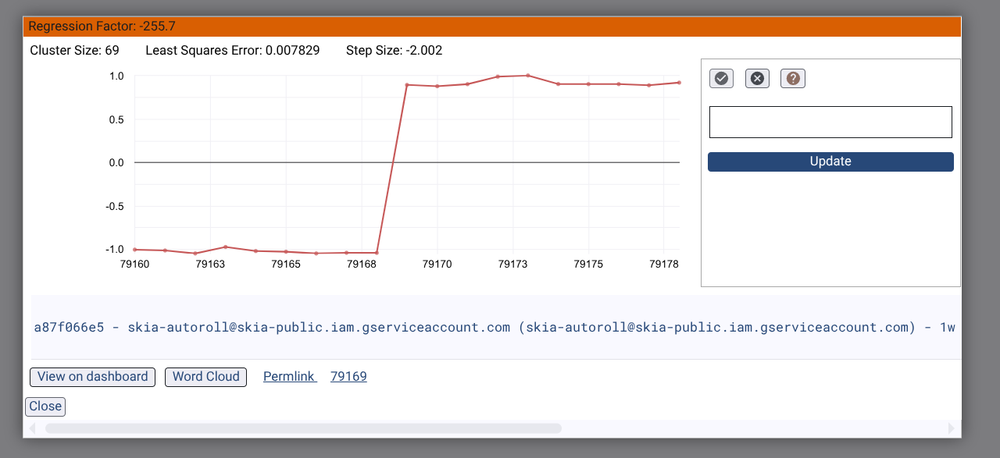
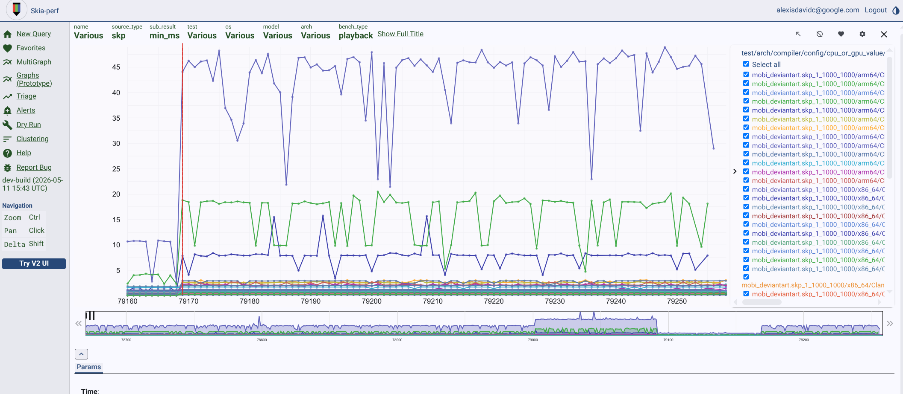
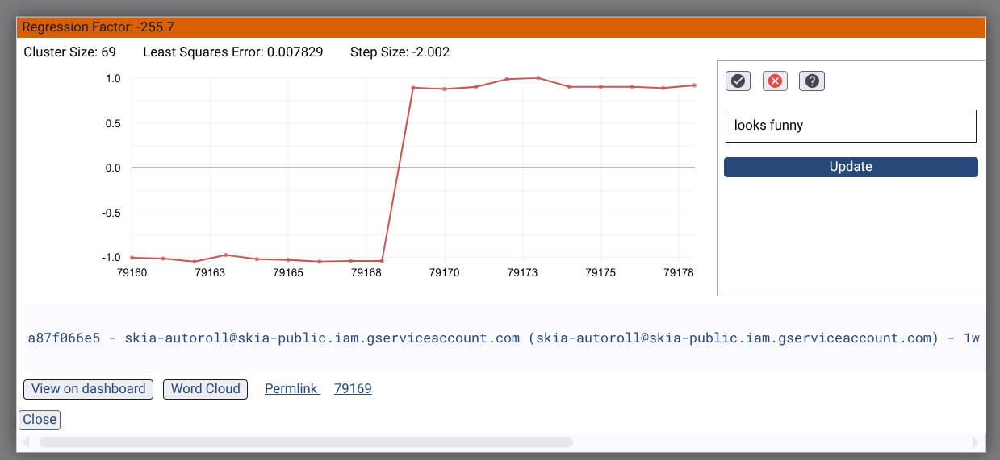

### Contents

- [What does a Skia Gardener do?](#what_is_a_skia_gardener)
  - [Skia tree](#skia_tree)
  - [Triage](#triage)
  - [Blamer](#blamer)
  - [AutoRollers](#autorollers)
  - [Gold and Perf](#gold_and_perf)
  - [Documentation](#skia_gardener_doc)
- [Preparing for your rotation](#preparations)
  - [Useful bookmarks](#useful_bookmarks)
  - [Chat rooms](#chat_rooms)
- [View current and upcoming rotations](#view_current_upcoming_rotations)
- [How to swap rotation shifts](#how_to_swap)
- [Tips for Skia Gardeners](#tips)
  - [When to file bugs](#when_to_file_bugs)
  - [How to close or re-open the tree](#how_close_tree)
  - [How to revert a CL](#how_to_revert)
  - [What to do if DEPS roll fails to land](#deps_roll_failures)
  - [How to rebaseline](#how_to_rebaseline)

## What does a Skia Gardener do?

---

A Skia Gardener keeps an eye on the tree, DEPS rolls, Gold tool, the Perf tool,
and triages Chrome bugs.

Below is a brief summary of what the gardener does for each task:

### Skia tree

- Understand the
  [testing infrastructure](https://skia.org/docs/dev/testing/automated_testing).
- Start watching the [status page](https://status.skia.org) for bot breakages.
- Track down people responsible for breakages and revert broken changes if there
  is no easy fix. You can use [blamer](#blamer) to help track down such changes.
   - For clean reverts, you need to add "Rubber Stamper" if the author isn't around to +1
     the change. See [go/rubber-stamper-user-guide](http://go/rubber-stamper-user-guide) for more.
   - For dirty reverts, you can use [go/skia-break-glass](http://go/skia-break-glass) to
     move quickly.
- Close and open the [tree](http://tree-status.skia.org).
- Keep the builder comments on the [status page](https://status.skia.org) up to
  date.
- File or follow up with
  [BreakingTheBuildbots bugs](https://bugs.chromium.org/p/skia/issues/list?q=label:BreakingTheBuildbots).
  See the tip on [when to file bugs](#when_to_file_bugs).
- Read and update the
  [Ongoing Issues section](https://docs.google.com/document/d/1y2jUf4vXI0fwhu2TiCLVIfWC1JOxFcHXGw39y7i-y_I/edit#heading=h.tpualuc3p7z0)
  in the handoff doc.
- (Optional) Document significant events that occurred during your shift in the
  [Weekly Handoff Notes section](https://docs.google.com/document/d/1y2jUf4vXI0fwhu2TiCLVIfWC1JOxFcHXGw39y7i-y_I/edit#heading=h.y49irwbutzr)
  in the handoff doc.

### Triage

You should triage Chromium, Skia, and OSS-fuzz bugs that show up under "Untriaged Bugs" on
the [status page](https://status.skia.org). The Android Gardener will triage the
untriaged Android Bugs. For a more detailed view of bugs see
[Skia Bugs Central](https://bugs-central.skia.org/).

To access the oss-fuzz bugs, see [go/skia-fuzz](http://go/skia-fuzz).

### Blamer

If you have Go installed, a command-line tool is available to search through git
history and do text searches on the full patch text and the commit message. To
install blamer run:

    go get go.skia.org/infra/blamer/go/blamer

Then run blamer from within a Skia checkout. For example, to search if the
string "SkDevice" has appeared in the last 10 commits:

    $ $GOPATH/bin/blamer --match SkDevice --num 10

    commit ea70c4bb22394c8dcc29a369d3422a2b8f3b3e80
    Author: robertphillips <robertphillips@google.com>
    Date:   Wed Jul 20 08:54:31 2016 -0700

        Remove SkDevice::accessRenderTarget virtual
        GOLD_TRYBOT_URL= https://gold.skia.org/search?issue=2167723002

        Review-Url: https://codereview.chromium.org/2167723002

### Autorollers

- Ensure that all AutoRollers listed on the
  [status page](https://status.skia.org) are successfully landing.

- If you notice an auto-roller is failing to land, and you believe you are not well equipped to resolve the issue, feel free to reach out for help. For example, if you are ill-equipped to resolve an ANGLE issue, you should rope in the GPU gardener.

### Gold and Perf

- Pay attention for new [Perf](https://perf.skia.org/) and
  [Gold](https://gold.skia.org/) alerts (by clicking on the bell at the top
  right of the [status page](https://status.skia.org)).
- The gardener's duty here is to make sure that when developers introduce new
  images or new perf regressions, that they are aware of what happened, and they
  use these tools to take appropriate action.

#### Basic workflow for triaging Perf issues

1. Look for the regressions link within the Skia Status page

2. Once you are at the regressions page, you can see a list of all current regression issues. This list only has 1.
It will tell you information about the CL that might have introduced a regression. In this case, the CL was an autoroll.

3. Look at the ? symbols underneath the performance "pillars". Each of these pillars will have a low and a high section referring to possible performance decreases or increases respectively. As we can never be sure whether a smaller number is positive or a larger number is positive, we track changes in either direction.

4. Once you click on any of the ? symbols, you will see a snapshot of what the regression looks like. There will be a lot of information in this window, such as the Least Squares Error (to show the confidence in whether this is not noise) and step size. You will also see the exact CL again, which you can copy the CL ID and search for it in Gerrit. This can help you investigate whether the CL actually might have caused the issue or, in the case of rolls, dig deeper in which CL it might have been.

5. You can click "view on dashboard" to get a better picture of what the issue looks like. This will also provide better context into what the preceding trend was before this CL. Make sure to expand the window range when viewing, as the regression could be transient. Make sure to look out for changes that impact a lot of devices, as this is a good indicator for a true regression. The red line here in this diagram indicates when the "problem" CL was introduced. Each line are tests run on different devices. The vertical refers to some metric in performance (e.g seconds) and the horizontal represents time (e.g. CLs). You may click the right hand check boxes to view or hide a line.

6. Once you confident in whether it looks like a regression or not, mark the corresponding check (for "not an issue") or x (for "this is an issue"). Fill out the justification text box. If you select the x, you will be taken to buganizer to file a bug related to this regression.

### Documentation

- Improve/update this documentation page for future gardeners, especially the
  [Tips section](#tips).

In general, gardeners should have a strong bias towards actions that keep the
tree green and then open; if a simple revert can fix the problem, the gardener
<b>should revert first and ask questions later</b>.

## Preparing for your rotation

---

### Useful bookmarks

- [The Chromium main console](https://ci.chromium.org/p/chromium/g/main/console).
- [The Flutter engine console](https://ci.chromium.org/p/flutter/g/engine/console).
- [Skia client search](http://go/skia-client-search),
  a tool for searching the codebases of all skia clients at once. See //tools/skia-client-search.html
  for the public version.

### Chat rooms

- [Flutter Engine Sherriff](https://chat.google.com/room/AAAAm69vf-M) room to
  watch for Flutter issues that are caused by Skia bugs or need assistance from
  our team.

## View current and upcoming rotations

---

The list of Skia Gardeners is specified
[here](http://go/skia-gardener-rotation). The
gardeners widget on the [status page](https://status.skia.org) also displays the
current gardeners.

## How to swap rotation shifts

---

If you need to swap shifts with someone (because you are out sick or on
vacation), please get approval from the person you want to swap with and
directly make the swap via the
[rotations page](http://go/skia-gardener-rotation).

## Tips for Skia Gardeners

---

### When to file bugs

Pay close attention to the "Failures" view in the
[status page](https://status.skia.org). Look at all existing
[BreakingTheBuildbots bugs](https://bug.skia.org/?q=label:BreakingTheBuildbots).
If the list is kept up to date then it should accurately represent everything
that is causing failures. If it does not, then please file/update bugs
accordingly.

### How to close or re-open the tree

1. Go to [tree-status.skia.org](https://tree-status.skia.org).
2. Change the status.

- To close the tree, include the word "closed" in the status.
- To open the tree, include the word "open" in the status.
- To caution the tree, include the word "caution" in the status.

### How to submit when the tree is closed

- Submit manually using the "git cl land" with the --bypass-hooks flag.
- Add "No-Tree-Checks: true" to your CL description and use the CQ as usual.

### How to revert a CL

See the revert documentation [here](https://skia.org/docs/dev/contrib/revert).

### Perf Tips

It's kind of the same as with gold, if you see a performance regression from a change, you usually want to notify the person who made the patch.

Perf will already do statistical anlysis in order to trigger the regression alert, so you can usually be confident that the regression it flags is real

Although the performance on some devices can be flaky, a regression will not regress only a single device, so pay attention to all the different devices.

For notifying someone of a regression:
- gpu driver -> notify gpu team
- if it's somebodies patch -> notify them
- if it's a roll from another google team -> investigate further

Sometimes perf will find a regression that is very tiny; you can ignore these
but use prudence.

Remember to zoom out and look at the overall trend of Perf, to see whether or not the issue is transient. Sometimes a Perf regression will be unrelated to the CL it is associated with, and the regression will actually come from flakiness or thermal throttling or a variety of other reasons.

### What to do if DEPS roll fails to land

A common cause of DEPS roll failures are layout tests. Find the offending Skia
CL by examining the commit hash range in the DEPS roll and revert (or talk to
the commit author if they are available). If you do revert then keep an eye on
the next DEPS roll to make sure it succeeds.

If a Skia CL changes layout tests, but the new images look good, the tests need
to be rebaselined. See [Rebaseline Layout Tests](#how_to_rebaseline).

### Rebaseline Layout Tests (i.e., add suppressions)

- First create a Chromium bug:

  - goto [crbug.com](https://crbug.com)
  - Make sure you're logged in with your Chromium credentials
  - Click “New Issue”
  - Summary: “Skia image rebaseline”
  - Description:
    - DEPS roll #,
    - Helpful message about what went wrong (e.g., “Changes to how lighting is
      scaled in Skia r#### changed the following images:”)
    - Layout tests affected
    - You should copy the list of affected from stdio of the failing bot
  - Status: Assigned
  - Owner: yourself
  - cc: bsalomon@, robertphillips@ & developer responsible for changes
  - Labels: OS-All & Cr-Blink-LayoutTests
  - If it is filter related, cc senorblanco@

- (Dispreferred but faster) Edit
  [skia/skia_test_expectations.txt](https://chromium.googlesource.com/chromium/+/refs/heads/trunk/skia/skia_test_expectations.txt)

  - Add # comment about what has changed (I usually paraphrase the crbug text)
  - Add line(s) like the following after the comment:
    - crbug.com/<bug#youjustcreated> foo/bar/test-name.html [ ImageOnlyFailure ]
  - Note: this change is usually done in the DEPS roll patch itself

- (Preferred but slower) Make a separate Blink patch by editing
  LayoutTests/TestExpectations

  - Add # comment about what has changed (I usually paraphrase the crbug text)
  - Add line(s) like the following after the comment:
    - crbug.com/<bug#youjustcreated> foo/bar/test-name.html [ Skip ] # needs
      rebaseline
  - Commit the patch you created and wait until it lands and rolls into Chrome

- Retry the DEPS roll (for the 1st/dispreferred option this usually means just
  retrying the layout bots)
- Make a Blink patch by editing LayoutTests/TestExpectations

  - Add # comment about what has changed
  - Add line(s) like the following after the comment:
    - crbug.com/<bug#youjustcreated> foo/bar/test-name.html [ Skip ] # needs
      rebaseline
      - (if you took the second option above you can just edit the existing
        line(s))

- If you took the first/dispreferred option above:
  - Wait for the Blink patch to roll into Chrome
  - Create a Chrome patch that removes your suppressions from
    skia/skia_test_expectations.txt
